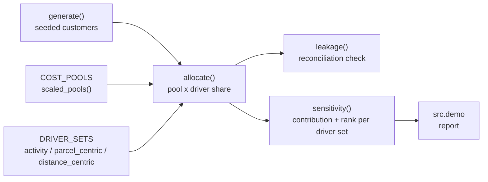

# costtoserve

Activity-based cost-to-serve for a parcel carrier, with allocation-driver sensitivity: it reports which customers change profitability sign depending on how cost is allocated.

[](https://github.com/nehakongari60-a11y/costtoserve/actions/workflows/ci.yml)

## Why

A carrier that prices by weight and zone tends to assume every customer above a revenue threshold is profitable. A customer with many small rural deliveries, frequent redelivery attempts and a high claims rate can be loss-making while ranking as a top account by revenue.

Activity-based costing (ABC) exposes this, but every ABC model rests on contestable choices: is last-mile cost driven per stop, per parcel or per kilometre? A model that picks one driver set and publishes a single ranked list invites an argument it cannot win. costtoserve runs the same cost pools under several defensible driver sets and reports where the answer depends on the choice.

## Features

- **Activity model as data.** Cost pools, candidate drivers and named driver sets are plain dictionaries in `src/model.py`; adding a driver set needs no code change.
- **Exact reconciliation.** Every pool is fully distributed under every driver set, and `leakage()` measures any cost that goes missing (it is zero in the tests).
- **Customer contribution** per driver set: revenue minus allocated cost, with the per-pool breakdown kept for traceability.
- **Sensitivity harness.** Per customer: contribution and rank under each driver set, rank spread, and a `sign_flips` flag when profitability changes sign between driver sets.
- **Synthetic fixture.** A seeded generator of 200 customers across three segments (national retail, e-commerce SME, rural specialist) with known cost behaviour.
- **Standard library only.** No dependencies to install.

## Architecture



`allocate()` spreads each cost pool across customers in proportion to the chosen driver. `sensitivity()` calls it once per driver set, ranks customers by contribution under each, and collects the results per customer. `src/demo.py` prints the reconciliation check and the findings. See [docs/ARCHITECTURE.md](docs/ARCHITECTURE.md) for the design notes.

## Quick start

Requires Python 3.11+. Nothing to install.

```bash
git clone https://github.com/nehakongari60-a11y/costtoserve.git
cd costtoserve
python -m src.demo                        # run the analysis on the fixture
python -m unittest discover -s tests -v   # run the tests
```

## Example output

`python -m src.demo` (trimmed):

```text
  200 customers, GBP 16,042,011 revenue, GBP 13,796,129 cost to allocate.

  Reconciliation:
    activity           unallocated: GBP    -0.000000
    parcel_centric     unallocated: GBP    -0.000000
    distance_centric   unallocated: GBP    -0.000000

    12 of the top 50 accounts by revenue are
    contribution-NEGATIVE under activity-based drivers.
    Separately, 19 of those top 50 change SIGN
    depending on which allocation driver you accept.

    customer          segment                  revenue       worst        best
    Rothwell 197      rural_specialist       1,828,161    -423,547     366,724
    Lindmoor 079      rural_specialist         839,948    -466,394      80,119

  Segment view (activity drivers):
    ecommerce_sme              108        23.9%
    retail_national             46        57.6%
    rural_specialist            46       -18.4%
```

These figures come from the synthetic fixture (seed `20260911`), not from real carrier data.

## How it works

- **Pools and drivers.** Seven cost pools (pickup, sortation, linehaul, last mile, redelivery, claims, customer service), each with two or three candidate drivers such as `stops`, `parcels`, `weight_kg` or `parcel_km`.
- **Driver sets.** `activity` follows the physical cause of each cost; `parcel_centric` spreads most pools per parcel (how many rate cards behave); `distance_centric` leans on distance.
- **Pool scaling.** `scaled_pools()` scales the pool totals so the whole book earns a 14% margin, keeping the relative pool sizes. Without it the fixture sits at break-even and every rank churns, which makes the sensitivity look like noise.
- **Sign flips versus rank movement.** A rank change is expected; a sign change means the account's profitability depends on an allocation judgement, so it is flagged for a commercial decision rather than reported as a costing result.

## Testing

```bash
python -m unittest discover -s tests -v
```

The 17 tests cover:

- zero leakage under every driver set, and full distribution of each pool;
- a customer with no activity absorbs no cost, and allocation traces back to pools;
- sign flips exist, ranks move between driver sets, and ranks are a permutation under each set;
- high-revenue accounts can be contribution-negative, and rural accounts cost more under activity drivers;
- every pool has at least two drivers, and a new driver set works without code changes.

## Project layout

```text
src/model.py       pools, drivers, allocation, sensitivity, fixture generator
src/demo.py        the analysis report
tests/             unittest suite
docs/              architecture and design notes
```

## Limitations

- Python reference implementation over synthetic data; there is no database, dbt layer or real shipment feed.
- Driver sets are hand-defined, not estimated from data.
- The cost pools are fixture values; real use needs the carrier's P&L totals.
- Sensitivity covers three driver sets, not the full combination of drivers.

## License

MIT, see [LICENSE](LICENSE).

## Maintainer

Maintained by **Neha Kongari**, Supply Chain Analyst, with a focus on cost-to-serve analysis, logistics and data analytics.

For project-related questions, contact [nehakongari60@gmail.com](mailto:nehakongari60@gmail.com).