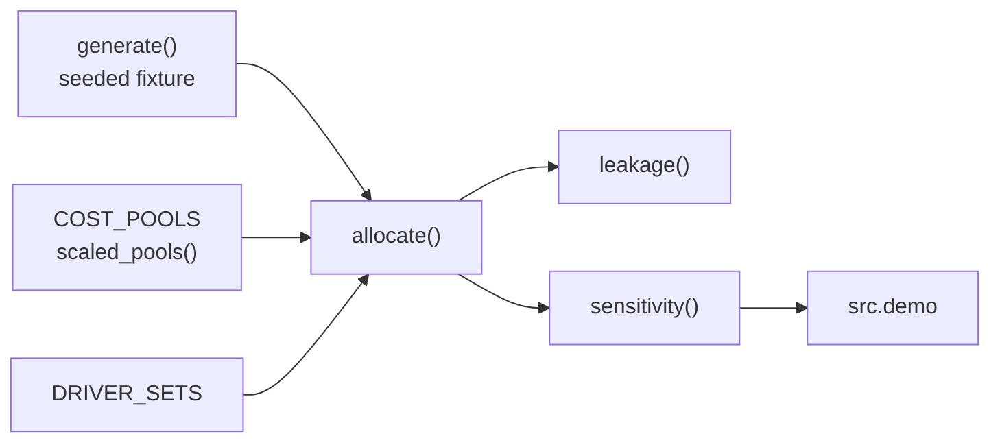

# Architecture

## Context

Carriers usually rank customers by revenue. Cost to serve differs sharply by segment, so the ranking can mislead. costtoserve allocates a fixed set of cost pools to customers under several allocation-driver sets and reports where the conclusion depends on the driver choice.

## Components

- `src/model.py` holds the whole model: pools, drivers, `Customer`, `Allocation`, `Sensitivity`, `allocate`, `leakage`, `sensitivity`, `scaled_pools` and `generate`.
- `src/demo.py` runs the model on the fixture and prints the report.

## Key decisions

**Drivers are data.** Pools, candidate drivers and driver sets are dictionaries, so a reviewer can add the view they prefer and see its effect without changing code. The cost is that a driver set must name a valid driver for every pool; a test enforces this.

**Run every driver set, report disagreement.** The alternative is to pick one driver set and present it as fact. That hides the contestable choice. Reporting rank spread and sign flips makes the uncertainty part of the output.

**Sign flips are the headline.** Rank churn is expected under any allocation change. A sign change means the verdict (profitable or not) depends on the allocation judgement, which is a commercial decision.

**Scale pools to the fixture.** Pool totals are P&L facts in real use. In the fixture they are scaled to a 14% overall margin so the population is not at break-even. Relative pool sizes are unchanged.

## Failure modes

- **Leakage.** A driver that is zero for some customers could drop cost silently. `allocate()` divides by the driver total, `leakage()` checks the sum against the pools, and tests assert it is zero for every driver set.
- **Empty driver total.** If a driver sums to zero the share is zero rather than raising; the leakage check would then show the missing cost.

## Out of scope

- A general ledger; the model reconciles to totals you supply.
- Pricing; the output is an input to pricing decisions.
- Estimating driver rates from shipment data.
